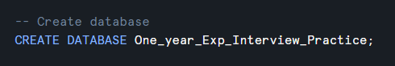
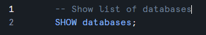
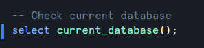
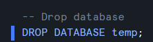

# Content

- [Content](#content)
- [Database inspection and exploration](#database-inspection-and-exploration)
  - [Display all databases](#display-all-databases)
  - [Display a specific database](#display-a-specific-database)
  - [Describe database properties](#describe-database-properties)
  - [Check current database](#check-current-database)
  - [Check current schema](#check-current-schema)
  - [Switch database context](#switch-database-context)
  - [Check database after switching](#check-database-after-switching)
  - [Inspect database schemas](#inspect-database-schemas)
  - [Inspect database grants](#inspect-database-grants)
  - [Compare multiple databases](#compare-multiple-databases)
  - [Create Database](#create-database)
  - [Create or replace a database](#create-or-replace-a-database)
  - [Show list of databases](#show-list-of-databases)
  - [Select / go to specific database](#select--go-to-specific-database)
  - [Check current database](#check-current-database-1)
  - [Use fully qualified names](#use-fully-qualified-names)
  - [View database information](#view-database-information)
  - [Drop database](#drop-database)
  - [Rename a database](#rename-a-database)
  - [Add or update or remove a comment](#add-or-update-or-remove-a-comment)
  - [Modify Time Travel retention](#modify-time-travel-retention)
  - [Modify multiple properties](#modify-multiple-properties)
  - [Create a database by cloning](#create-a-database-by-cloning)
  - [Create a database from a share](#create-a-database-from-a-share)
  - [Restore a dropped database](#restore-a-dropped-database)
  - [Find database metadata](#find-database-metadata)
  - [Grant access to a database](#grant-access-to-a-database)
  - [End-to-end practice](#end-to-end-practice)

&nbsp;

&nbsp;

&nbsp;

# Database inspection and exploration

Objective: Understand existing databases and inspect their configurations.

## Display all databases

```sql
SHOW DATABASES;
```

&nbsp;

## Display a specific database

```sql
SHOW DATABASES LIKE 'RAW_DB';
```

&nbsp;

## Describe database properties

```sql
DESC DATABASE RAW_DB;
```

&nbsp;

## Check current database

```sql
SELECT CURRENT_DATABASE();
```

&nbsp;

## Check current schema

```sql
SELECT CURRENT_SCHEMA();
```

&nbsp;

## Switch database context

```sql
USE DATABASE ANALYTICS_DB;
```

&nbsp;

## Check database after switching

```sql
SELECT CURRENT_DATABASE();
```

&nbsp;

## Inspect database schemas

```sql
SHOW SCHEMAS IN DATABASE ANALYTICS_DB;
```

&nbsp;

## Inspect database grants

```sql
SHOW GRANTS ON DATABASE ANALYTICS_DB;
```

&nbsp;

## Compare multiple databases

```sql

```

&nbsp;

&nbsp;

&nbsp;

&nbsp;

## Create Database

```sql
CREATE DATABASE DB_NAME;
```

Create only if it does not already exist

```sql
CREATE DATABASE IF NOT EXISTS DB_NAME;
```



&nbsp;

Create a transient database

```sql
CREATE TRANSIENT DATABASE TRANSIENT_DB;
```

&nbsp;

&nbsp;

## Create or replace a database

```sql
CREATE OR REPLACE DATABASE DB_NAME;
```

> Warning: If the database already exists, this command replaces it. Existing objects may become inaccessible through the replaced database, so avoid it in production unless replacement is intentional.

&nbsp;

&nbsp;

## Show list of databases

```sql
SHOW DATABASES;
```

You can filter the results:

```sql
SHOW DATABASES LIKE 'SANDBOX%';
```

The results depend on the active role's privileges.



&nbsp;

&nbsp;

## Select / go to specific database

```sql
use database one_year_exp_interview_practice;
```


After executing this query, `one_year_exp_interview_practice` becomes the current database for the session.

&nbsp;

&nbsp;

## Check current database

```sql
select current_database();
```



## Use fully qualified names

The current database and schema provide default context for object names. Use a fully qualified name (`DATABASE.SCHEMA.OBJECT`) when you want to make the target explicit:

```sql
SELECT * FROM SANDBOX_DB.HR.EMPLOYEE;
```

Set the current database for subsequent commands:

```sql
USE DATABASE SANDBOX_DB;
```

Check the current database and schema:

```sql
SELECT CURRENT_DATABASE(), CURRENT_SCHEMA();
```

&nbsp;

&nbsp;

## View database information

```sql
DESCRIBE DATABASE DB_NAME;
```

This provides database properties such as its owner, retention settings and other metadata. `SHOW DATABASES` is useful for listing databases and seeing summary metadata.

&nbsp;

&nbsp;

## Drop database

```sql
DROP DATABASE database_name;
```

Dropping a database removes the database and its contained objects. This is destructive; verify the name and active role before running it. Use `DROP DATABASE IF EXISTS DB_NAME;` when absence is an acceptable no-op.



&nbsp;

&nbsp;

## Rename a database

```sql
ALTER DATABASE old_name
RENAME TO new_name;
```

&nbsp;

&nbsp;

## Add or update or remove a comment

```sql
ALTER DATABASE db_name
SET COMMENT = 'any comment';
```

&nbsp;

Remove the comment:

```sql

ALTER DATABASE DB_NAME
UNSET COMMENT;
```

&nbsp;

&nbsp;

## Modify Time Travel retention

```sql
ALTER DATABASE SANDBOX_DB
SET DATA_RETENTION_TIME_IN_DAYS = 1;
```

This configures the database-level retention setting.

Important: Database-level retention acts as a default for contained objects. Check individual object retention settings when investigating actual Time Travel behavior.

&nbsp;

&nbsp;

## Modify multiple properties

```sql
ALTER DATABASE SANDBOX_DB
SET
    COMMENT = 'Updated sandbox database',
    DATA_RETENTION_TIME_IN_DAYS = 1;
```

Separate properties in an `ALTER ... SET` statement with commas.

&nbsp;

&nbsp;

&nbsp;

&nbsp;

## Create a database by cloning

Snowflake supports zero-copy cloning:

```sql
CREATE DATABASE EMPLOYEE_DB_DEV
CLONE EMPLOYEE_ANALYTICS_DB;
```

This creates a development copy without immediately duplicating all underlying storage.

&nbsp;

&nbsp;

## Create a database from a share

```sql
CREATE DATABASE SHARED_DATA_DB
FROM SHARE PROVIDER_ACCOUNT.SHARE_NAME;
```

This is used when another Snowflake account shares data with your account.

&nbsp;

&nbsp;

## Restore a dropped database

If the database is still within its Time Travel retention period:

```sql
UNDROP DATABASE EMPLOYEE_ANALYTICS_DB;
```

This applies to a dropped permanent database while its Time Travel retention is available. Transient databases cannot be recovered with `UNDROP`.

&nbsp;

&nbsp;

## Find database metadata

```sql
SELECT
    DATABASE_NAME,
    DATABASE_OWNER,
    CREATED,
    LAST_ALTERED,
    RETENTION_TIME,
    COMMENT
FROM SNOWFLAKE.ACCOUNT_USAGE.DATABASES
WHERE DELETED IS NULL
ORDER BY CREATED DESC;
```

`ACCOUNT_USAGE` views can have latency and require appropriate account-level privileges. For a quick interactive listing, use `SHOW DATABASES`.

&nbsp;

&nbsp;

## Grant access to a database

```sql
GRANT USAGE
ON DATABASE EMPLOYEE_ANALYTICS_DB
TO ROLE DATA_ENGINEER_ROLE;
```

Database `USAGE` alone does not provide access to its schemas or tables. Those privileges must also be granted:

```sql
GRANT USAGE
ON SCHEMA EMPLOYEE_ANALYTICS_DB.RAW
TO ROLE DATA_ENGINEER_ROLE;

GRANT SELECT
ON ALL TABLES IN SCHEMA EMPLOYEE_ANALYTICS_DB.RAW
TO ROLE DATA_ENGINEER_ROLE;
```

`ON ALL TABLES` applies to existing tables. Use a future grant if the role should receive access to tables created later:

```sql
GRANT SELECT
ON FUTURE TABLES IN SCHEMA EMPLOYEE_ANALYTICS_DB.RAW
TO ROLE DATA_ENGINEER_ROLE;
```

## End-to-end practice

Run this in a non-production account with a role that can create databases and schemas. The `CREATE` statements do not reset existing objects; the `INSERT` is not idempotent and should be run only once unless you first remove the sample rows.

```sql
CREATE DATABASE IF NOT EXISTS SANDBOX_DB
    DATA_RETENTION_TIME_IN_DAYS = 1
    COMMENT = 'Database for Snowflake administration practice';

CREATE SCHEMA IF NOT EXISTS SANDBOX_DB.HR;
CREATE SCHEMA IF NOT EXISTS SANDBOX_DB.SALES;

CREATE TABLE IF NOT EXISTS SANDBOX_DB.HR.EMPLOYEE (
    EMPLOYEE_ID NUMBER,
    FIRST_NAME VARCHAR,
    LAST_NAME VARCHAR,
    DEPARTMENT VARCHAR
);

INSERT INTO SANDBOX_DB.HR.EMPLOYEE
    (EMPLOYEE_ID, FIRST_NAME, LAST_NAME, DEPARTMENT)
VALUES
    (1, 'Asha', 'Rao', 'HR'),
    (2, 'Noah', 'Kim', 'Sales'),
    (3, 'Mia', 'Patel', 'Engineering');

SELECT COUNT(*) AS EMPLOYEE_COUNT
FROM SANDBOX_DB.HR.EMPLOYEE;

ALTER DATABASE SANDBOX_DB
    SET COMMENT = 'Sandbox database for database-object practice',
        DATA_RETENTION_TIME_IN_DAYS = 1;

DESCRIBE DATABASE SANDBOX_DB;
SHOW SCHEMAS IN DATABASE SANDBOX_DB;
SELECT * FROM SANDBOX_DB.HR.EMPLOYEE ORDER BY EMPLOYEE_ID;
```

To rerun the insert portion without duplicating rows, remove the sample rows first or use a fresh sandbox database. Do not use `CREATE OR REPLACE DATABASE` to reset a database unless replacing all contained objects is intentional.

&nbsp;

&nbsp;
