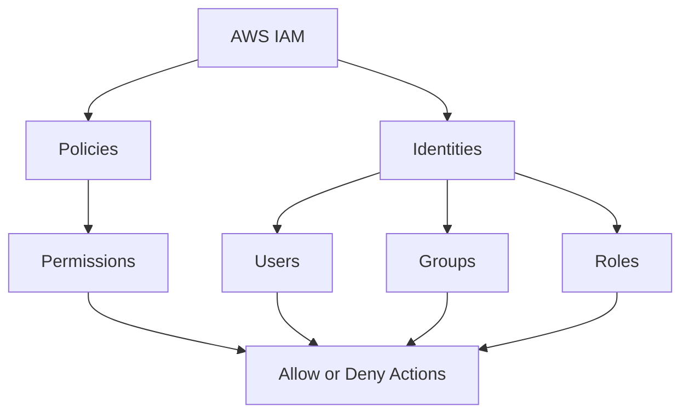
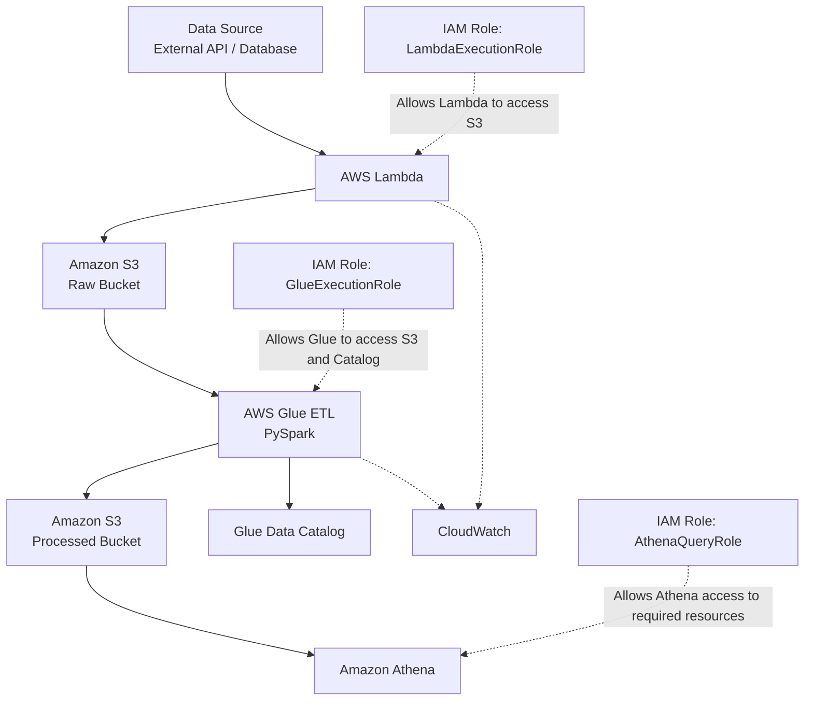

# Content

- [Content](#content)
- [Concept and Definition](#concept-and-definition)
- [IAM architecture](#iam-architecture)
- [Key concepts](#key-concepts)
- [Understand how permissions work](#understand-how-permissions-work)
- [Why is access management important](#why-is-access-management-important)
- [Note](#note)

&nbsp;

&nbsp;

&nbsp;

# Concept and Definition

AWS uses IAM (Identity and Access Management) to manage access securely.

AWS Access and Permissions determine:

- Who can access AWS resources.
- Which AWS resources they can access.
- What actions they can perform.
- Under which conditions they can access resources.

&nbsp;

&nbsp;

# IAM architecture

&nbsp;

&nbsp;

# Key concepts

| Concept         | Meaning                                        | Example              |
| --------------- | ---------------------------------------------- | -------------------- |
| IAM User        | Identity for a person or application           | Developer user       |
| IAM Group       | Collection of IAM users                        | DataEngineerGroup    |
| IAM Role        | Identity that AWS services or users can assume | LambdaExecutionRole  |
| IAM Policy      | JSON document defining permissions             | Allow S3 read access |
| Permission      | Action an identity is allowed or denied        | `s3:GetObject`       |
| Resource        | AWS object on which an action is performed     | S3 bucket            |
| Trust Policy    | Defines who can assume a role                  | Lambda service       |
| Least Privilege | Grant only the permissions required            | Read-only S3 access  |

&nbsp;

&nbsp;

# Understand how permissions work

&nbsp;

&nbsp;

# Why is access management important

As a Data Engineer, you may work with:

- S3 buckets containing raw and processed data.
- Lambda functions processing uploaded files.
- Glue jobs transforming datasets.
- Redshift databases storing analytical data.
- CloudWatch logs monitoring pipeline execution.

&nbsp;

Not every user or service should have access to every resource.

For example:

- Lambda should read files from S3.
- Glue should read raw files and write processed files.
- Analysts should only access approved datasets.
- Developers should not automatically have administrative permissions.

&nbsp;

&nbsp;

&nbsp;

&nbsp;

&nbsp;

&nbsp;

&nbsp;

# Note

- AWS IAM is offered at no additional cost, meaning AWS does not charge separately for creating and managing users, groups, roles, and policies. However, the AWS resources accessed through IAM, such as S3, Lambda, and Glue, may have their own usage-based charges.

&nbsp;

- IAM is global service. It means IAM is not restricted to a specific AWS Region. You can manage IAM users, roles, groups, and policies from one AWS account, and they are generally available across all Regions in that account.

&nbsp;

- The AWS Root User is created automatically when you create an AWS account. It is the high level account. It has complete administrative access to that AWS account. AWS recommends that you do not use or share the root user for daily activities because it has unrestricted access to critical account-level operations.

&nbsp;

&nbsp;

&nbsp;
