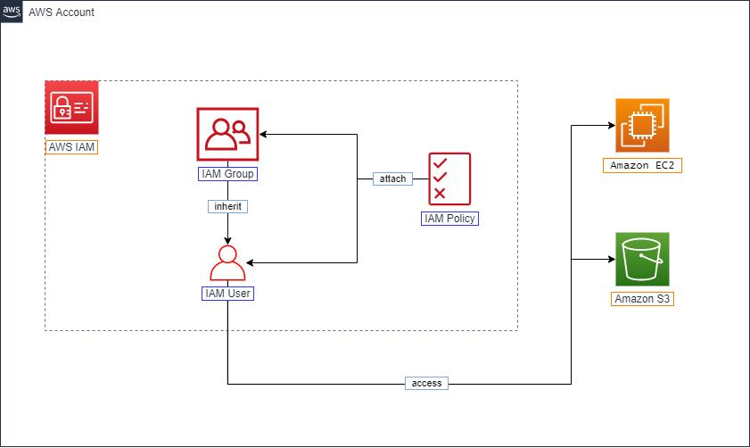

# Content

- [Content](#content)
- [IAM User (Identity and Access Management User)](#iam-user-identity-and-access-management-user)
- [Example](#example)
- [Why do we need IAM Users](#why-do-we-need-iam-users)
- [IAM User Architecture](#iam-user-architecture)
- [How IAM User Architecture works](#how-iam-user-architecture-works)
- [IAM User vs Root User vs IAM Role](#iam-user-vs-root-user-vs-iam-role)
- [Interview Question:](#interview-question)

&nbsp;

&nbsp;

&nbsp;

# IAM User (Identity and Access Management User)

An IAM User is an identity created in AWS to represent a person or application that needs access to AWS resources.

For example, in a Data Engineering team, you might create separate IAM identities for developers, administrators, and read-only users.

&nbsp;

&nbsp;

An IAM User can have:

- A username and password for AWS Management Console access.
- Access keys (Access Key ID and Secret Access Key) for programmatic access through AWS CLI, SDKs, or APIs.
- Permissions through IAM policies, either directly or through IAM groups.

&nbsp;

&nbsp;

| Concept           | Meaning                                           | Example                |
| ----------------- | ------------------------------------------------- | ---------------------- |
| IAM User          | Identity representing a person or application     | `data_engineer_user`   |
| Username          | Unique name assigned to the user                  | `chaitaly`             |
| Password          | Used to access AWS Management Console             | Console login password |
| Access Key ID     | Public identifier for programmatic authentication | `AKIA...`              |
| Secret Access Key | Secret credential used with the access key        | Stored securely        |
| IAM Policy        | Defines what actions the user can perform         | `S3ReadOnlyPolicy`     |
| IAM Group         | Collection of IAM users with common permissions   | `DataEngineers`        |

&nbsp;

&nbsp;

# Example

Suppose your company has three Data Engineers.

| IAM User      | Responsibility      | Required Access |
| ------------- | ------------------- | --------------- |
| DataEngineer1 | Data ingestion      | S3, Lambda      |
| DataEngineer2 | Data transformation | S3, Glue        |
| DataEngineer3 | Data analytics      | Athena, S3      |

Instead of sharing the root account credentials, each engineer gets an individual identity with appropriate permissions.

&nbsp;

Example: Data Engineer accessing S3

1. Create an IAM User named data_engineer.
2. Create an IAM policy allowing read access to a specific S3 bucket.
3. Attach the policy to the user or an IAM group.
4. The user authenticates using AWS credentials.
5. The user can read permitted S3 objects.

&nbsp;

&nbsp;

Important Points

- IAM Users are identities, not permissions.
- Permissions are defined through IAM policies.
- Follow the principle of least privilege.
- Avoid sharing IAM user credentials.
- Prefer IAM Roles and temporary credentials for AWS workloads such as Lambda, Glue and EC2 instead of creating long-lived access keys.

&nbsp;

&nbsp;

# Why do we need IAM Users

| Purpose           | Explanation                                        |
| ----------------- | -------------------------------------------------- |
| Individual Access | Each employee gets a separate identity             |
| Authentication    | Verifies who is accessing AWS                      |
| Authorization     | Controls which AWS actions are allowed             |
| Security          | Avoids sharing root credentials                    |
| Accountability    | Helps identify which identity performed an action  |
| Access Control    | Provides permissions based on job responsibilities |

&nbsp;

&nbsp;

# IAM User Architecture

&nbsp;

&nbsp;

# How IAM User Architecture works

1. Administrator creates an IAM user.
2. User receives login credentials or programmatic credentials.
3. User authenticates with AWS.
4. AWS evaluates the permissions attached directly to the user or inherited through groups.
5. AWS allows or denies the requested action.
6. AWS records relevant activity through services such as CloudTrail.

&nbsp;

&nbsp;

# IAM User vs Root User vs IAM Role

| Feature        | Root User                                           | IAM User                             | IAM Role                                         |
| -------------- | --------------------------------------------------- | ------------------------------------ | ------------------------------------------------ |
| Created By     | AWS during account creation                         | Administrator or authorized identity | Administrator or authorized identity             |
| Identity       | Account owner                                       | Individual or application identity   | Assumed identity                                 |
| Permissions    | Full account access, subject to applicable controls | Assigned permissions                 | Assigned permissions                             |
| Credentials    | Root email and password                             | Password and/or access keys          | Temporary credentials when assumed               |
| Daily Usage    | Avoid                                               | Use only when appropriate            | Preferred for AWS workloads                      |
| Can Be Shared? | Never                                               | No                                   | Can be assumed by multiple authorized principals |
| Example        | Account owner                                       | Developer                            | GlueExecutionRole                                |

&nbsp;

&nbsp;

&nbsp;

# Interview Question:

1. What is an IAM user?
2. What is the difference between an IAM user and an IAM role and IAM Group?
3. Can an IAM user belong to multiple IAM groups?
4. Can permissions be attached directly to an IAM user?
5. What happens when an IAM user has no permissions?
6. Why should we avoid sharing IAM user credentials?
7. How does AWS evaluate IAM policies?
8. Can an IAM User access S3 without permissions?
9. What happens if an IAM User has Allow and Deny permissions for the same action?
10. Should we use IAM Users for Lambda execution?
11. What is the difference between authentication and authorization?
